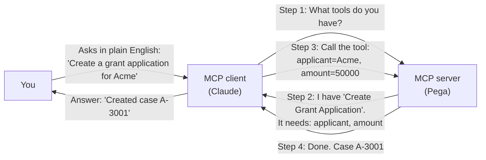
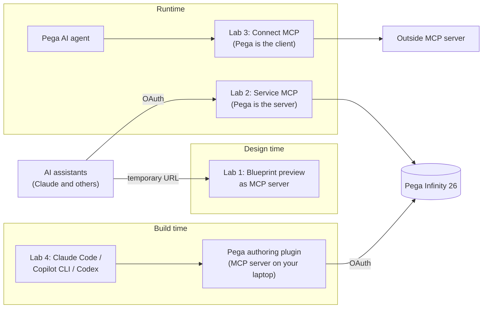
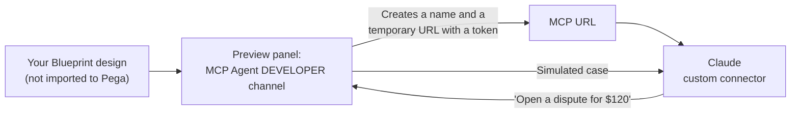
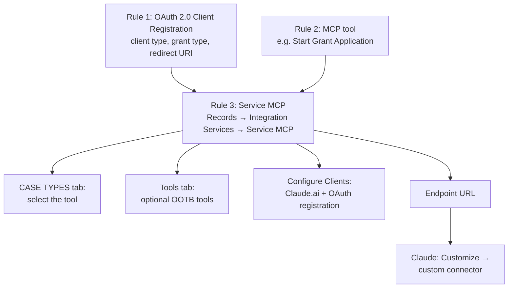
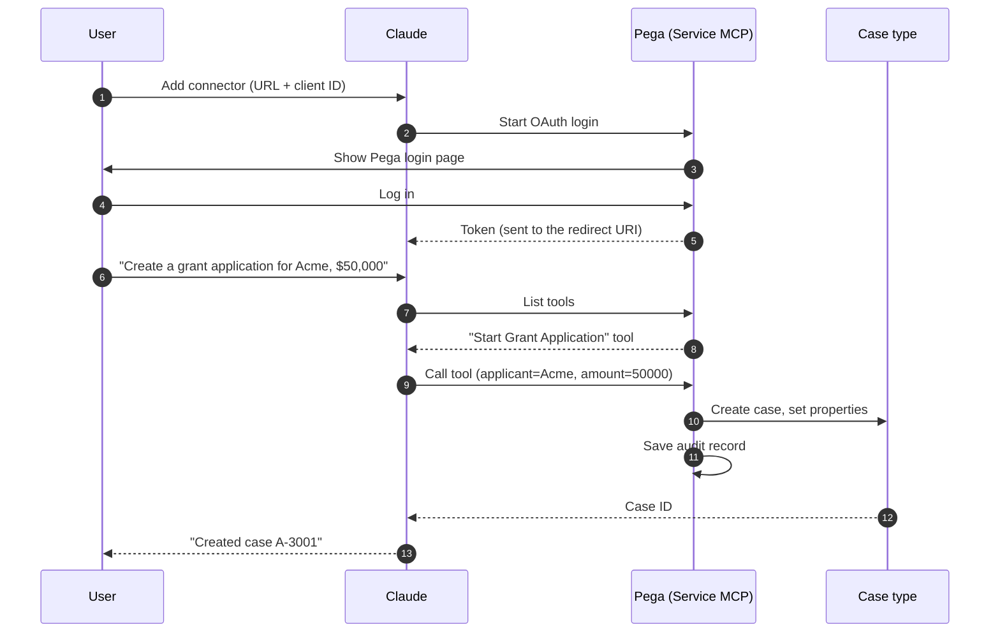
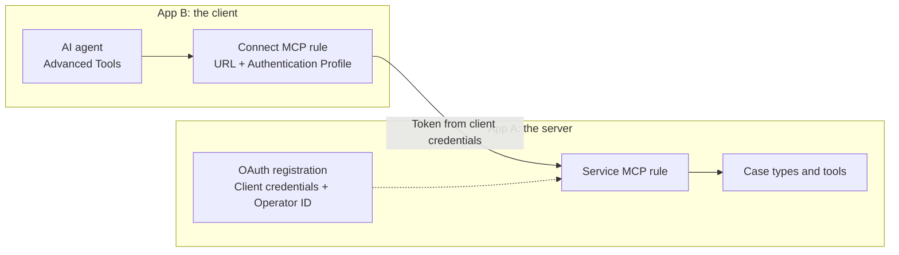
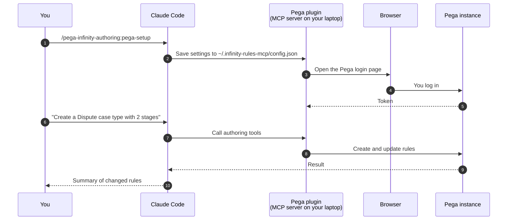

MCP is a standard plug that lets AI tools talk to other systems. Pega Infinity 26 supports this plug in four places. These notes explain the basic ideas first. Then they walk you through four labs, from the easiest to the hardest.

- **Lab 1 (easiest):** Connect an AI assistant to a Pega Blueprint design. You do not need a Pega instance.
- **Lab 2:** Let Claude create real cases in your Pega application.
- **Lab 3:** Let a Pega AI agent use tools from outside Pega.
- **Lab 4:** Let a coding assistant, such as Claude Code, build Pega rules for you.

Read Part 1 first if MCP or OAuth is new to you.

**Where this information comes from:** Pega Forums posts, the Pega GitHub repository, and Pega press releases. I did not find the official docs.pega.com pages for these features. Treat each step as a starting point. Check it on your own instance.

---

## Part 1: The basic ideas

### What problem does MCP solve?

An AI assistant, such as Claude or ChatGPT, is good at language. By itself, it cannot open a case in your Pega application. It does not know your case types. It cannot log in.

Before MCP, each AI vendor and each system needed a custom integration. Ten AI tools and ten systems meant up to one hundred integrations.

MCP (Model Context Protocol) is one standard way to connect them. A system describes what it can do in a standard format. Any AI tool that speaks MCP can then use it.

A simple comparison: MCP is like a USB port for AI. The system gives the port. The AI tool plugs in.

### The four words you need

- **MCP server:** The system that offers capabilities. In Lab 2, Pega is the MCP server.
- **MCP client:** The AI tool that uses those capabilities. In Lab 2, Claude is the MCP client.
- **Tool:** One action that the server offers. Example: "Create a grant application." Each tool has a name, a description, and the inputs it needs.
- **Endpoint URL:** The web address of the MCP server. The client connects to this address.



What happens in this flow:

1. The client asks the server for its list of tools.
2. The server sends back each tool and the inputs it needs.
3. The AI reads your request and picks the right tool. It fills in the inputs from your words.
4. The server runs the action and returns the result.

The AI decides **which** tool to call. Pega decides **whether** the call is allowed and **how** the work is done. Keep this split in mind. It matters for security.

### Pega can be on either side

Pega can be the server, the client, or both.

- **Pega as the server:** an outside AI tool works in Pega. The Pega rule for this is **Service MCP**. (Lab 2)
- **Pega as the client:** a Pega AI agent uses tools outside Pega. The Pega rule for this is **Connect MCP**. (Lab 3)

This matches how Pega already names integrations. A "Service" rule lets others call Pega. A "Connect" rule lets Pega call others. If you know Service REST and Connect REST, you already know the pattern.

### What is OAuth, and why does every lab need it?

An MCP server must know who is calling. Otherwise, anyone with the URL could create cases.

OAuth 2.0 is the standard way to answer "who is calling, and what may they do?" The AI tool never sees the user's Pega password. It gets a **token** instead. A token is a temporary pass that Pega can check and cancel.

Pega uses two OAuth styles (called **grant types**) for MCP:

| Grant type | When to use it | What happens | The work runs as |
|---|---|---|---|
| **Authorization code** | A person uses an AI assistant | The person logs in to Pega once. Pega gives the assistant a token. | That person |
| **Client credentials** | A machine calls Pega, such as another Pega app | The machine proves its identity with a client ID and a secret. No person logs in. | A named Pega operator |

The rule of thumb:

- If a person is in the conversation, use **authorization code**.
- If no person is involved, use **client credentials**.

In Pega, you set this up in an **OAuth 2.0 Client Registration** rule. There are two client types:

- **Public client:** for tools that cannot keep a secret safe, such as a chat app. It uses authorization code.
- **Confidential client:** for servers that can keep a secret safe. It can use client credentials.

### Pega terms used in these notes

- **Case type:** A business process in Pega, such as "Grant Application" or "Dispute."
- **Rule:** Any configuration item in Pega. Case types, OAuth registrations, and MCP services are all rules.
- **Operator:** A Pega user account.
- **Access group:** The set of permissions an operator has.
- **Data page:** A Pega rule that loads and caches data.
- **Constellation:** Pega's current UI architecture.
- **UI Kit:** Pega's older UI architecture. Some MCP features are not yet confirmed on UI Kit.
- **Dev Studio / App Studio / Infinity Studio:** Pega's design-time tools. Infinity Studio is the unified tool in Infinity 26.
- **OOTB:** Out of the box. A feature Pega already provides.

### The big picture



---

## Part 2: Before you start

### What you need

- A Pega Infinity 26 instance (for Labs 2, 3, and 4). Lab 3 also works on Pega Platform 25.1.3.
- Access to Pega Blueprint (for Lab 1).
- A Claude account (for Labs 1 and 2).
- Admin rights in your Pega application, so you can create rules.
- For Lab 4: Node.js 22.14 or newer and Java 17 or newer on your laptop.

### Check network access first

This is the most common reason a first attempt fails.

- Claude runs in the cloud. It must reach your Pega instance over the internet.
- On **Pega Labs** instances, a forum user got "Authorization with the MCP server failed." The fix was a support ticket. The Pega Lab team then allowed traffic from Claude.
- On **Community** and **Academy** editions, it is not clear whether this traffic is allowed. Raise a support ticket to check.
- **Microsoft Copilot Studio** has a known problem. It sends requests from changing IP addresses. Pega Cloud accepts requests only from approved IP addresses. So Copilot Studio cannot connect directly.

If you work at a bank, expect the same IP allowlist problem with any cloud AI tool. Talk to the network team before you plan a demo.

### Use a sandbox

Do every lab on a personal or sandbox instance. Do not use a client's production system.

---

## Part 3: The labs

### Lab 1: Talk to a Blueprint design (no Pega instance needed)

**Goal:** See MCP work end to end in about 30 minutes, with no rules and no OAuth.

**What you will learn:** How an AI client discovers and calls tools.

**Why start here:** Blueprint creates a temporary MCP server for your design. You can test a workflow with an AI assistant before anyone builds it in Pega. Nothing touches a real environment.



**Steps**

1. In Pega Blueprint, create a small design. Example: a card dispute with three stages.
2. Open the workflow preview.
3. Select the **MCP Agent DEVELOPER** channel.
4. Blueprint shows a unique name and a temporary MCP URL. The URL includes a token.
5. In Claude, add a custom MCP connector. Paste the URL.
6. Ask Claude: "What can you do?" Claude lists the tools from your design.
7. Ask Claude: "Open a dispute for $120 on my last card payment."
8. Watch Claude call the tools and walk through your simulated workflow.

**What to notice**

- You did not write any tool definitions. Blueprint created them from your design.
- The quality of the AI's choices depends on clear stage and step names. Vague names give vague results.

**If it does not work**

- Some users report that their Claude account does not allow the custom connector this preview needs.
- A community member published a local workaround called the Universal MCP Gateway (`pega-blueprint-mcp-gateway` on GitHub). It runs on your laptop and forwards requests. It is not a Pega product. Read its code before you give it your token.

**Security note:** The URL contains a token. Anyone with the URL can use it. Do not share it in screenshots, chats, or tickets.

**Checklist**

- ☐ Build a small Blueprint.
- ☐ Turn on the MCP Agent DEVELOPER channel.
- ☐ Connect Claude and run one request end to end.
- ☐ Rename one step to something vague. Run the same request. Compare the result.

---

### Lab 2: Let Claude create real cases in Pega (Service MCP)

**Goal:** A user types a request in Claude. Claude creates a real case in your Pega application.

**What you will learn:** How to make Pega an MCP server, and how OAuth protects it.

**Why it matters:** This is the main runtime feature of Infinity 26. Users can start work from the AI tool they already use, without opening Pega.

**Version note:** The Service MCP rule type first appeared in 25.1.3. The steps below come from an Infinity 26.1 walkthrough.

#### How the pieces fit together

You create three rules. Each one has one job.

| Rule | Its job | Simple comparison |
|---|---|---|
| **OAuth 2.0 Client Registration** | Decides who may connect, and how they log in | The door lock |
| **MCP tool** | Describes one action and the inputs it needs | One item on a menu |
| **Service MCP** | Publishes the tools at one URL | The menu itself |



#### Step 1: Create the OAuth 2.0 client registration (the lock)

**Why:** Claude needs a way to log the user in to Pega. This rule tells Pega how.

1. Create a new **OAuth 2.0 Client Registration** rule. In Dev Studio, it is under **Records → Security**.
2. Under **Client Credentials → Type of client**, select **Public**.
   - Why Public: Claude is a chat app used by people. It uses the authorization code flow, where each person logs in.
3. Under **Supported grant types**, configure **authorization code**.
4. Add this redirect URI:

```text
https://claude.ai/api/mcp/auth_callback
```

**What is a redirect URI?** After the user logs in to Pega, Pega must send them back to Claude. The redirect URI is the address Pega sends them back to. Pega only redirects to addresses on this list. This stops an attacker from stealing the login.

#### Step 2: Create an MCP tool (one item on the menu)

**Why:** The tool tells the AI what it can do and what inputs it must provide.

1. Create a new MCP tool. Example: "Start a grant application intake."
2. On the **ACTION** tab, select the case type the tool creates.
3. On the **PARAMETERS** tab, add the inputs the AI must supply. Examples: applicant organization, requested amount, contact email.

**Tips**

- Give the tool a clear name and description. The AI reads them to decide when to use the tool.
- Name each parameter the same as the case property it fills. In the walkthrough, this was enough. Pega filled the case properties directly from the AI's values. This was on a Constellation case type.
- Create one tool per action. Small, clear tools work better than one large tool.

#### Step 3: Create the Service MCP rule (the menu)

**Why:** This rule publishes your tools at one address that AI clients can reach.

1. Go to **Records → Integration Services → Service MCP**.
2. Create a new rule. Enable the MCP service for your application.
3. On the **CASE TYPES** tab, select the tool from Step 2.
4. Optional: on the **Tools** tab, add OOTB tools. The forum examples used OOTB tools that let the AI update fields, add Pulse notes, read the current assignment, complete an assignment, and change the stage.
   - For a first lab, start with only your own tool. Add OOTB tools later. Fewer tools make it easier to see what the AI does.
5. Under **Configure Clients**, select **Claude.ai** and the OAuth registration from Step 1. Pega fills in the connection details. Copy them to a note.
6. Save the rule. Copy the endpoint URL.

The endpoint URL looks like this:

```text
https://<host>/prweb/app/<app-alias>/api/service/v1/mcp/Rule-Service-MCP!<ServiceName>
```

#### Step 4: Connect Claude (plug in)

1. In claude.ai, open **Customize** in the left menu.
2. Add a **custom connector**.
3. Enter the endpoint URL and the OAuth client ID. Click **Add**.
4. Click **Connect**. Claude opens the Pega login page.
5. Log in with your Pega operator ID and password.
6. Pega sends you back to Claude.
7. Check that the connector lists your Pega tools.



Note: the user logs in once. After that, Claude uses the token. Every tool call runs as that user, with that user's permissions.

#### Step 5: Test

1. Ask Claude to create a case. Give it specific values.
2. Claude calls the tool and returns a case ID.
3. Open the case in Pega. Check that each property matches what you typed.

#### Step 6: Check the audit record

**Why:** In a regulated business, you must be able to show what the AI did.

- Pega saves each MCP interaction as an instance of the `Pega-Autopilot-Conversation` class.
- Each record shows the request Claude sent and the response Pega returned.
- Open the latest record. Find your request.

#### Common problems

**"Authorization with the MCP server failed"**

- Most likely a network block. See "Check network access first" in Part 2.
- Also check that the redirect URI matches exactly. One wrong character breaks it.

**The case is created, but the fields are empty (UI Kit applications)**

- The walkthrough author tested only Constellation case types.
- One user created a UI Kit case but could not fill its properties from the tool inputs.
- Things to try:
  - Make each tool parameter name match the case property name exactly.
  - Use the case's `pyDefault` data transform to copy the incoming values into the case.
- Another contributor said the OOTB `pxCommon` MCP service may need a view for each assignment in UI Kit applications. Pega has not confirmed this yet.

**Other AI clients**

- A forum author also tested Service MCP with GitHub Copilot in VS Code and other MCP clients.
- Pega says ChatGPT and Microsoft 365 Copilot can call Pega through MCP. I found no public step-by-step guide for either. Test before you promise it to anyone.

**Checklist**

- ☐ Create the OAuth registration with the Claude redirect URI.
- ☐ Create one MCP tool for one case type.
- ☐ Create the Service MCP rule and copy the URL.
- ☐ Connect Claude and log in.
- ☐ Create one case from Claude.
- ☐ Find the matching `Pega-Autopilot-Conversation` record.

---

### Lab 3: Let a Pega agent use outside tools (Connect MCP)

**Goal:** A Pega AI agent, working inside a case, calls a tool from another system.

**What you will learn:** How Pega acts as an MCP client.

**Why it matters:** Your Pega agent can use tools from other systems without a custom integration for each one.

**Version note:** The first walkthrough used Pega Platform 25.1.3.

#### Part A: Connect to a simple outside tool

The walkthrough used a public test server with time-zone tools. It needs no login, so it is a good first test:

```text
https://date-time-tools.iabhishek.workers.dev/mcp
```

This is a community test server. Use it for learning only. Never send real data to it.

**Steps**

1. Create a **Connect MCP** rule. Enter the MCP server URL.
2. Click **Test connectivity**. If it works, Pega lists the tools the server offers.
3. Open an **AI Agent** rule. Go to the **Advanced Tools** tab. Under **External Agents and Tools**, add the Connect MCP rule.
   - The walkthrough author could not see the Advanced Tools tab in App Studio. Use Dev Studio.
4. Open the case type. On the **UX** tab, add the AI agent to **Full Page View → Agents**.
5. Create a new case. Click the **Chat with AI** icon in the bottom-right corner.
6. Ask: "What can you do for me?" The agent lists what its tools can do.
7. Ask: "Convert the current time to Korean time."
8. Run **AI Tracer**. Confirm that the agent called the outside tool.

**Why use AI Tracer:** The answer alone does not prove the agent used the tool. The AI could guess. AI Tracer shows the actual tool call.

Note: The forum posts call this rule both "Connect MCP" and "MCP Connector." They mean the same rule type.

#### Part B: Connect two Pega applications

**Goal:** An agent in App B works cases in App A.

This combines Lab 2 and Lab 3. App A is the server. App B is the client. The example used Infinity 26.1.1.

This time no person logs in to App A. So use **client credentials** instead of authorization code.



**In App A (the server)**

1. Create an MCP tool for the case type. Add its parameters.
2. Create a Service MCP rule. Select the tool. Add OOTB tools on the **Tools** tab if needed.
3. Create an OAuth 2.0 client registration:
   - Under **Supported grant types**, select **Client credentials** and **Operator ID**.
   - Click **View & download** before you save. The file has the client ID, the client secret, and the access token endpoint.
   - Keep this file secret. Store it in a password vault, not in email or chat.

**What does Operator ID mean here?** Pega runs every call as the operator you name. That operator's access group decides what the agent can do. Create a dedicated operator with only the access it needs.

**In App B (the client)**

1. Create an **Authentication Profile**:
   - Enter the client ID and the client secret from the file.
   - Enter the access token endpoint from the file.
2. Create the **Connect MCP** rule:
   - Enter the endpoint URL from App A's Service MCP rule.
   - Select the Authentication Profile.
   - Click **Test connectivity**. App A's tools appear.
3. Create an AI agent. Add the Connect MCP rule under **Advanced Tools**. Add OOTB tools in the **Actions** section if needed.
4. Add the agent to a case type on the **UX** tab.

**What the agent could do in the example**

- Create a case in App A.
- Update fields and add a Pulse note.
- Read and complete the current assignment.
- Move the case to the Resolve stage.
- Create a PDF of the case, attach it, and email it.
- Answer list and count questions without report definitions.

**What did not work perfectly**

- The same prompt did not always give the same result. Sometimes a field update needed a second prompt.
- The agent did not remember earlier chats. You had to give it the case ID again.

#### Agent tool or workflow step?

This is the most important design choice in Lab 3.

- **As an agent tool:** the AI decides whether to call the tool. Good for work that needs judgment.
- **As a workflow step:** in Infinity 26, you can call a Connect MCP rule as a step in the case flow. It runs every time. Pega maps the response to the case.

The rule of thumb:

- If the call must happen every time, use a **workflow step**.
- If the call depends on the situation, use an **agent tool**, with a person approving where it matters.

**Checklist**

- ☐ Connect to the public test server and see its tools.
- ☐ Add the Connect MCP rule to an agent.
- ☐ Run one request and confirm it in AI Tracer.
- ☐ Optional: connect two Pega apps with client credentials.

---

### Lab 4: Let Claude Code build Pega rules (authoring plugin)

**Goal:** You describe a change in your coding assistant. It creates or updates rules in your Pega instance.

**What you will learn:** How Pega uses MCP at build time.

**Why it matters:** Pega now supports popular coding assistants for Pega development, not only its own tools.

**How it works:** Pega publishes a plugin. The plugin runs a small MCP server on your laptop. Your coding assistant talks to that local server. The local server talks to your Pega instance.



#### What it is

- The plugin is at `github.com/pegasystems/infinity-ai-plugins`.
- It supports Claude Code, GitHub Copilot CLI, OpenAI Codex, Devin, and OpenCode.
- Release 0.2.1 has MCP server 0.7.11 and skills 0.1.14.
- The bundled skills target Pega Infinity 24-2, 25-1, and 26-1, according to an open issue in the repository.

#### Before you install

- Install Node.js 22.14 or newer.
- Install Java 17 or newer. The MCP server is a Java program.
- On first use, the plugin downloads its files and checks them against fixed SHA-256 hashes. This proves the files were not changed.

#### Install in Claude Code

```bash
claude plugin marketplace add https://github.com/pegasystems/infinity-ai-plugins.git
claude plugin install pega-infinity-authoring@Pega
```

Then, inside Claude Code, run the setup skill:

```text
/pega-infinity-authoring:pega-setup
```

The setup skill asks for:

- Your Pega instance URL.
- Your OAuth client ID.

Then a browser window opens. Log in to Pega. This is the authorization code flow from Part 1.

The setup saves your settings in `~/.infinity-rules-mcp/config.json`.

#### Install in other tools

```bash
# GitHub Copilot CLI (restart Copilot CLI afterward)
copilot plugin marketplace add https://github.com/pegasystems/infinity-ai-plugins.git
copilot plugin install pega-infinity-authoring@Pega

# OpenAI Codex
codex plugin marketplace add https://github.com/pegasystems/infinity-ai-plugins.git
codex plugin add pega-infinity-authoring@Pega
```

#### First test

1. Ask Claude Code: "Create a case type called Dispute with two stages: Review and Resolve."
2. Read the summary of rules it created.
3. Open the case type in Pega. Check that it matches.
4. Check the rule history. Note which operator Pega shows as the author.

#### Work with more than one environment

By default, the plugin connects to one Pega instance. To use a different instance for each project:

1. Create `<project-root>/.infinity-rules-mcp/config.json` with that instance's URL.
2. Add this to `<project-root>/.claude/settings.local.json`:

```json
{
  "env": {
    "INFINITY_RULES_MCP_CONFIG_FILE": "${CLAUDE_PROJECT_DIR}/.infinity-rules-mcp/config.json"
  }
}
```

A forum user reports that this works in Claude Code CLI and in Claude Desktop.

#### Update the plugin

```bash
claude plugin marketplace update Pega
claude plugin update pega-infinity-authoring@Pega
```

Then run `/reload-plugins` or start a new session.

#### Things to know

- **Use a sandbox.** The plugin changes real rules. Do not point it at a production instance.
- **Review every change.** The assistant can make mistakes. Read the rules it creates before you use them.
- **License limit:** the Pega Infinity AI Plugins License allows use only with Pegasystems software. Read it before you build your own tools on top of the plugin.
- **Other coding tools:** one user ran the plugin in Devin (formerly Windsurf) on Infinity 26.1 and created a decision table. Another user got 401 errors in Windsurf.

**Checklist**

- ☐ Install Node.js and Java.
- ☐ Install the plugin and run `pega-setup`.
- ☐ Create one case type from Claude Code.
- ☐ Create one decision table.
- ☐ Note what was right, what was wrong, and how long it took.

---

## Part 4: Going further

### Older Pega versions

For Pega Infinity 23 and later with the DX API turned on, a community project called `marco-looy/pega-dx-mcp` wraps the DX API as MCP tools.

- It is experimental. It is not a Pega product.
- On 25.1.3 or 26, use Service MCP instead.

```bash
claude mcp add-json pega-dx-mcp '{"command":"npx","args":["-y","@marco-looy/pega-dx-mcp"],"env":{"PEGA_BASE_URL":"https://your-pega-instance.com","PEGA_CLIENT_ID":"your-client-id","PEGA_CLIENT_SECRET":"your-client-secret","PEGA_API_VERSION":"v2"}}'
```

### MCP or A2A?

You will also see A2A (Agent-to-Agent protocol). Pega Infinity 26 supports both.

- **MCP** connects an agent to a capability, such as a case type or a tool.
- **A2A** connects one agent to another agent.
- Use MCP when an AI assistant needs to work Pega cases, or when a Pega agent needs an outside tool.

### Security checklist for a regulated client

These are my recommendations, not Pega guidance.

- ☐ Start with read-only tools. Add tools that create or change data later.
- ☐ Expose one case type per Service MCP rule. Do not expose the whole application.
- ☐ For people, use authorization code. Each call then runs as a named user.
- ☐ For machines, create a dedicated operator with a narrow access group.
- ☐ Register each AI client separately. Then you can turn off one client and keep the others.
- ☐ Check that the audit record shows the client, the user, and the tool for every call.
- ☐ Set a retention period for `Pega-Autopilot-Conversation` records. They can contain customer data.
- ☐ Use workflow steps for calls that must always happen.
- ☐ Solve IP allowlist issues before the demo.
- ☐ Use the authoring plugin only on sandbox and development instances.

### What is proven, and what is only claimed

Pega's press release says Infinity 26 works with Claude Code, GitHub Copilot, Codex, Claude, ChatGPT, and Microsoft 365 Copilot. My research found different levels of evidence:

- **Clear public steps:** the authoring plugin for Claude Code, Copilot CLI, and Codex; Claude as a runtime client.
- **Reported by community users:** GitHub Copilot in VS Code; Devin.
- **Claimed, with no public guide found:** ChatGPT; Microsoft 365 Copilot.
- **Known problem:** Copilot Studio with Pega Cloud, because of IP allowlists.

### Related on Caseonix

- [Pega GenAI Autopilot: what adoption really takes](/notes/pega-autopilot-lab-notes.html), my earlier notes on Autopilot in App Studio.
- [Banks told AI agents to stay out. Here is the architecture that lets them back in.](/blog/banks-ai-agents-architecture.html), on agent gateways for regulated clients.

---

## Glossary

- **Access token / token:** A temporary pass that proves a client may call Pega. Pega can cancel it.
- **AI Tracer:** A Pega tool that shows which tools an AI agent called.
- **Authentication Profile:** A Pega rule that stores how Pega logs in to another system.
- **Authorization code:** An OAuth grant type where a person logs in.
- **Client credentials:** An OAuth grant type where a machine logs in with an ID and a secret.
- **Connect MCP:** The Pega rule that lets Pega use an outside MCP server.
- **Endpoint URL:** The web address of an MCP server.
- **MCP (Model Context Protocol):** A standard way for AI tools to connect to other systems.
- **MCP client:** The AI tool that uses an MCP server.
- **MCP server:** The system that offers tools through MCP.
- **Redirect URI:** The address Pega sends a user back to after login.
- **Service MCP:** The Pega rule that makes Pega an MCP server.
- **Tool:** One action an MCP server offers, with its inputs.

---

## Sources

- Pega Forums, "How to expose Pega as MCP server for external AI clients (Infinity '26)."
- Pega Forums, "Pega Infinity '26 MCP Server and Pega 25.1.3 MCP Connect."
- Pega Forums, "How to connect Pega AI Agent to external MCP server."
- Pega Forums, "How to use MCP to connect two Pega apps and use AI agent to work cases in the other Pega app," October 21, 2026.
- Pega Forums, "Service MCP Authentication in Pega 26."
- Pega Forums, "Issue while exposing pega as MCP server with Copilot Studio."
- Pega Forums, "Exposing Pega Workflows to LLMs via MCP."
- Pega Forums, "MCP Agent feature in Blueprint Preview."
- Pega Forums, "Blueprint MCP Preview With A Universal MCP Gateway."
- Pega Forums, "Pega AI plugin: connecting to multiple environments."
- Pega Forums, "Agentic development through MCP - Unable to access."
- Pega Forums, "Anyone tried running Pega Infinity AI Plugins (MCP) inside Windsurf?"
- Pega Forums, "MCP or A2A."
- GitHub, pegasystems/infinity-ai-plugins (README, release 0.2.1, issue #35).
- GitHub, WeekendNoobs/pi-pega-mcp-bridge (license note).
- GitHub, marco-looy/pega-dx-mcp.
- Business Wire, "Pega Infinity 26 Now Available to Deliver Predictable Outcomes with Predictable AI Costs," July 14, 2026.
